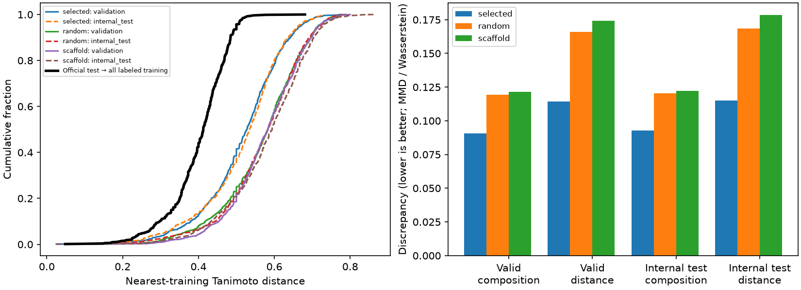

# Molecular similarity and split matching

This infrastructure creates a prospective 60/20/20 train/validation/internal-test
partition within the official labeled training snapshot. The organizer's blinded
test remains external. No model is fitted, selected, or submitted by these commands.
Existing folds, recipes, and training loaders are unchanged.

Use validation to select a checkpoint within each model run. Score that same
checkpoint on internal test to compare strategies, without another fit. Because
internal test ranks strategies repeatedly, it is a development/strategy-selection
set, not an independent final evaluation. These molecules have also appeared in
past experiments; the partition is not historically untouched. Freeze assignments
before future model comparisons and establish fresh baselines after adoption.

## Representation and targets

Reuse the repository's molecular parent standardization: RDKit Cleanup, largest
organic fragment, uncharging, then canonical non-isomeric SMILES. Invalid or missing
structures fail. Duplicate records remain records; identical parents always stay
together. Official training/test parent overlap fails, regardless of molecule IDs.

Generate bit-vector Morgan fingerprints with radius 2 and 2,048 bits, bond types
and ring membership enabled, chirality and count simulation disabled. This is
ECFP4-like: the 4 denotes environment diameter, whereas RDKit takes a radius.
Use Tanimoto similarity and `distance = 1 - similarity`. See the
[RDKit reference](https://www.rdkit.org/docs/GettingStartedInPython.html).
Fingerprint collisions or stereochemistry removal can yield distance zero for
otherwise different molecules; zero fingerprint distance does not define identity.

The optimization has four equally weighted, baseline-normalized terms:

1. Validation chemical composition versus official blind-test composition.
2. Validation nearest-training distance distribution versus the target distribution.
3. Internal-test chemical composition versus official blind-test composition.
4. Internal-test nearest-training distance distribution versus the same target.

Composition uses the square root of biased empirical kernel MMD with Tanimoto as
the kernel. For holdout H and blind test B, its square is
`mean(K(H,H)) + mean(K(B,B)) - 2 mean(K(H,B))`, including diagonals. Numerical negative
roundoff is clamped to zero. This compares whole distributions; it does not simply
pick each official-test molecule's closest counterpart.

Difficulty uses Wasserstein-1 between nearest-reference distances. The fixed
target is official blind test versus **all** official labeled training parents.
Each proposed holdout is measured against its candidate 60% training partition.
This explicitly targets the chemistry available to the challenge's eventual
full-data fit. The audit additionally shows blind test versus the retained 60%
training pool, exposing the effect of reference-pool size. No claim is made that
these conditions are identical, or that molecular distance determines assay error.

Unique parents have equal weight in optimization. Reports also show record-weighted
nearest-training summaries, endpoint coverage, scaffold overlap, and property
summaries (weight, logP, TPSA, heavy atoms, rings). Activity values, confidence
intervals, predictions, and model scores never enter the objective. Only label
availability is retained, to require at least 100 labels for each scored endpoint
in both holdouts. Test labels are neither required nor read.

SIMPD is precedent for matching chemical distributions during split construction,
but this is **not SIMPD**: it targets this known unlabeled test population rather
than simulated medicinal-chemistry time shifts. See the
[SIMPD paper](https://pmc.ncbi.nlm.nih.gov/articles/PMC10712068/).
Using official-test structures is a transductive evaluation-design choice; it does
not establish correlation with official scores or authorize challenge submission.

## Deterministic search and approval

Parents are sorted before any seeded operation. Seed 42 assigns `floor(N/5)`
parents to each holdout, with the remainder in training. Actual record counts
may differ slightly from 60/20/20 because parents are indivisible.

Evaluate 128 seed-42 random partitions, retaining those that meet endpoint label
coverage. Fail if none is feasible. The **componentwise median objectives** of
those feasible draws define both the approval baseline and normalization scales
(floored at 0.01). Record the 10th/50th/90th percentiles and feasible count. For
visualization, `random-assignments.csv` is the actual random partition closest to
the median vector in normalized absolute distance; its objectives are not the
approval baseline, since the componentwise median need not describe one partition.

Start local search from the best aggregate random candidate. Evaluate up to 8,192
cross-partition swap proposals, stopping early after 1,024 consecutive proposals
without an aggregate improvement. Swaps preserve parent counts and must retain
coverage. Record the evaluated proposal count, proposals since improvement, and
whether the search exhausted its budget or stopped on patience. Neither stopping
condition proves global convergence. `--swaps` and `--patience` override these limits.

Across all candidates, retain the lowest aggregate-loss candidate with all four
objectives no worse than the random medians and strictly improved aggregate loss
(tolerance 1e-12). If none qualifies, preserve the lowest-loss candidate as
**unapproved**, write `candidate-assignments.csv`, and exit 2. Approval means
relative improvement over typical random splits, not sufficient absolute match
or authorization for training adoption. Do not change split parameters after
observing downstream model scores to make a model look favorable.

A scaffold-grouped baseline targets the same proportions but never splits a
scaffold, including the shared empty scaffold of acyclic molecules. It can have
very different actual counts or sparse labels; diagnostics expose this rather
than breaking groups. If fewer than three scaffolds exist, it is unavailable.
It is a comparison baseline, not the matching objective.

## Commands and artifacts

Install `.[reports]` for HTML/PNG/SVG reports (the supported Conda environment
already includes matplotlib). Use `--no-report` to generate or audit assignments
and JSON artifacts with only core dependencies.

Install the project normally to obtain `openadmet-molecular-split`, or run from a
checkout with `PYTHONPATH=src python -m somerra_openadmet.molecular_split_cli`.

```bash
openadmet-molecular-split generate \
  --training /private/training.csv \
  --official-test /private/cyp-challenge-TEST-BLINDED.csv \
  --output runs/molecular-split-v1 \
  --supplement official_auxiliary=/private/official-auxiliary/assays.csv

openadmet-molecular-split audit \
  --training /private/training.csv \
  --official-test /private/cyp-challenge-TEST-BLINDED.csv \
  --assignments runs/molecular-split-v1/assignments.csv \
  --output runs/molecular-split-v1-audit \
  --supplement scigantic_chembl=/private/scigantic_chembl/assays.csv \
  --supplement scigantic_pubchem=/private/scigantic_pubchem/assays.csv
```

Training CSVs require `Molecule_Name`, `SMILES`, and the four canonical direct
endpoint columns. Blind-test CSVs require the two identifier columns only.
Existing prepared `parent`/`fold` columns are ignored: parents are recalculated
from SMILES and old folds cannot influence the search. Supplemental CSVs accept
`SMILES`, `smiles`, or standardized `parent` columns, in that preference order;
long-form repeated assay records are reduced to unique parents for diagnostics.
Use repeated `--supplement NAME=CSV` arguments for separate sources.

Every output directory must be new. Outputs are:

- `manifest.json`: status, hashes, versions, seed, representation, settings,
  evaluation semantics, and assignment hash. It never activates a training split.
- `assignments.csv` only for an approved generated split; otherwise
  `candidate-assignments.csv`, including audit-only runs. Schema: `Molecule_Name`,
  `parent`, `partition` (`train`, `validation`, `internal_test`).
- Random/scaffold assignments, `search.json` with feasible/infeasible proposal
  history, and `audit.json` with full aggregate diagnostics, endpoint-specific distance summaries, an
  optimistic distance-feasibility bound, and distance vectors.
- `report.html`, `matching-diagnostics.svg`, and `matching-diagnostics.png`, with no
  external scripts or assets, unless `--no-report` is specified.

Generation returns exit code 2 for an unapproved candidate. Invalid inputs and
infeasible baseline coverage fail explicitly. Auditing existing assignments does
not approve them and validates exact ID coverage, standardized-parent alignment,
partition membership, and parent disjointness.

Supplemental sources do not affect optimization. Audit their exact overlap with
each partition, remove every validation/internal-test/official-test parent from
their eligible pool, then report held-out distance to that eligible pool. Keep
analogues. Empty eligible pools are reported explicitly. Large reference pools
are compared in chunks. These are diagnostics: downstream training integration
must enforce the same exclusions, fit transformations on training only, and use
label/task-specific source eligibility. This PR does not change existing training loaders. In particular,
`neural.screen` calls `data_sources.official.neural_training_frame`, which uses
`allowed_auxiliary` to exclude analogues at Tanimoto >= 0.6. That policy is
incompatible with this split's exact-only source audit. Before adoption, the
training path must load the frozen assignments, enforce exact exclusions for
**both** internal holdouts and official test, retain analogues, and reject any
manifest/training-policy mismatch. Apply the rule during source preparation too:
pre-filtered source snapshots may already have lost the required analogues.
The manifest records `required_training_exclusion_policy: exact_parent_only` and
`analogue_exclusion_threshold: null`; these declarations do not activate or
validate a training loader. Keep historical recipes on their historical policy.

Keep all assignments, distance vectors, challenge data, and reports in ignored
private artifact directories. The independent PR contains reusable code, synthetic
tests, documentation, and aggregate audit evidence only. No GPU allocation is used.

## Initial CPU audit — 2026-10-26 (superseded search settings)

The default search passed its relative-improvement gate. The selected assignments
were identical before and after the independent source audit; assignment SHA-256:
`28dea7fa5c18fbddabc452ea3018e98cd7facecbf26b3177bc19a6b94e1f74d1`.
The frozen labeled snapshot contained 4,905 records / 4,901 parents; the blind test
contained 750 records / 748 parents. Private artifacts are retained under
`runs/molecular-splits-20261026-final` in the shared project artifact store.

| Partition | Parents | Records | CYP1A2 labels | CYP2C9 labels | CYP2D6 labels | CYP3A4 labels |
| --- | ---: | ---: | ---: | ---: | ---: | ---: |
| Train | 2,941 | 2,943 | 870 | 777 | 915 | 1,351 |
| Validation | 980 | 982 | 278 | 258 | 289 | 520 |
| Internal test | 980 | 980 | 264 | 250 | 289 | 464 |

| Discrepancy (lower is better) | Random | Matched |
| --- | ---: | ---: |
| Validation composition MMD | 0.11956 | 0.11196 |
| Validation distance Wasserstein | 0.16456 | 0.15027 |
| Internal-test composition MMD | 0.12181 | 0.11398 |
| Internal-test distance Wasserstein | 0.16648 | 0.15309 |

The normalized aggregate discrepancy decreased **7.38%**, with all four terms
improving. Nevertheless, internal-test median distance to training is **0.5688**,
compared with **0.4127** for the official test against all labeled training, and
**0.4603** for the official test against the retained 60% training pool. The
remaining mismatch is substantial: passing the relative gate does not mean the
split reproduces official-test difficulty, and it is not automatic adoption.


The new holdouts overlap 1,960 parents in the official auxiliary source, 75 in the
pinned ChEMBL derivative and 67 in the pinned PubChem derivative. Exact exclusion
leaves 4,181, 24,824 and 17,592 eligible source parents, respectively. These are
structural source counts, not guarantees of selected-task label coverage. No
source in this audit has an exact official-test parent overlap. The underlying
assays remain sparse, unlike the densely assayed blind test; structure matching
cannot resolve that difference or measure unobserved endpoint distributions.

No GPU training, model promotion, split adoption, or challenge submission was
performed. A follow-up training integration must load the frozen assignments,
enforce all exclusions, and retrain the baseline before comparing new scores.


## Mismatch investigation and limits

The [organizer's construction description](https://openadmet.ghost.io/announcing-openadmets-cyp-inhibition-blind-challenge/)
says the blind test expands around 25 potent hits for each of CYP1A2, CYP2C9 and
CYP3A4, purchasing ten analogues per hit and assaying all four endpoints. A held-out
sample of the original sparse screening data does not reproduce that process.

Under this fingerprint representation, 44.1% of official-test parents have a
labeled training neighbor within distance 0.4. Two 980-parent holdouts would need
about 865 such parents to match that proportion, but only 516 of all 4,901 labeled
parents have any *other* labeled parent that close. This is an optimistic bound:
it even permits other held-out molecules as references. Therefore both holdouts
cannot exactly match the fixed official-test-to-full-training distance target at
60/20/20, irrespective of search quality. More search can still improve the match.
The audit exposes support counts at distances 0.3, 0.4, 0.5 and 0.6; these are
necessary support checks, not a complete feasibility proof for other targets.

Endpoint diagnostics compare labeled holdout parents to retained parents labeled
for that same CYP, and all official-test parents to both the retained and full
endpoint-labeled pools. Empty pools are explicit. The four optimization objectives
remain pooled structural objectives; endpoint diagnostics are not secretly added
to selection. Supplemental task coverage is a separate issue.

Potency enrichment is not reproduced by a structure-only split. A future protocol
could select potent seed molecules using only a **previously fixed training
partition**, then select analogues structurally. Ranking all candidate parents by
potency before choosing holdouts would use held-out outcomes. Such a protocol
requires its own documented contract; it is not enabled here. Sparse internal
endpoint labels also cannot reproduce a densely assayed panel, and matching
structures cannot guarantee matching activity distributions or ST-RAE denominators.


## Revised CPU audit after review — 2026-10-26

The median baseline uses all 128 feasible random candidates. The longer search
completed 8,192 proposals and passed the relative gate. It stopped on its
**proposal budget**, not patience: there were 116 improvements in the last 1,024
proposals and only two proposals since the last improvement. It is not converged.

| Discrepancy (lower is better) | Median random baseline | Revised candidate |
| --- | ---: | ---: |
| Validation composition MMD | 0.11967 | 0.09060 |
| Validation distance Wasserstein | 0.16577 | 0.11435 |
| Internal-test composition MMD | 0.12024 | 0.09291 |
| Internal-test distance Wasserstein | 0.16617 | 0.11486 |

Aggregate normalized discrepancy is **27.23% below the random medians**. The
original 7.38% used one random draw, so these percentages have different reference
baselines. The revised internal-test median distance is **0.5348**, down from
0.5688; validation is 0.5279. The fixed official-test/full-training target remains
0.4127. Official test against the revised retained training partition is **0.5000**
(previously 0.4603): optimizing the four holdout objectives can remove training
neighbors useful to the official test. That retained-pool statistic is diagnostic,
not constrained by the objective. This tradeoff and the support bound mean the
candidate is not a validated proxy for leaderboard rankings or automatically adopted.

| Partition | Parents | Records | CYP1A2 labels | CYP2C9 labels | CYP2D6 labels | CYP3A4 labels |
| --- | ---: | ---: | ---: | ---: | ---: | ---: |
| Train | 2,941 | 2,944 | 860 | 739 | 976 | 1,267 |
| Validation | 980 | 980 | 283 | 273 | 256 | 545 |
| Internal test | 980 | 981 | 269 | 273 | 261 | 523 |

Exact-parent exclusion leaves 4,181 official-auxiliary parents, 24,827 pinned
ChEMBL parents and 17,593 pinned PubChem parents eligible. These remain structural
counts for the supplied snapshots, not endpoint/task eligibility guarantees.



The plotted random baseline is a representative actual draw, whereas the approval
gate and table above use componentwise medians. Private artifacts are in
`runs/molecular-splits-20261026-review`. Assignment SHA-256:
`9e69d2ec25402ad2c1d96b8f4169785926917af3db1531d552515b0167780318`.
No training was launched and neither the original nor revised split was adopted.
